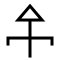
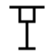
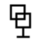
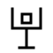
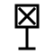

# Veles Productions — Brand Book 3.2

*November 2026. Replaces VELES-Brandbook v0 in colour, type and graphic element; the logo and
its usage rules carry over. This is the new Veles brand.*

Live version with motion: https://veles-productions.github.io/veles-brand-kit/

---

## 1. Who we are.

Veles Productions is a Warsaw studio, founded in 2022. We produce films and commercials,
run virtual production on LED walls, build real-time worlds and design AI agents. Our clients
come from film, television, broadcast, entertainment, games, medicine and defence.

**Tagline:** *Shaping Digital Worlds for Human Future.* (never translated)
**Also:** *The impossible projects studio.* · *Stories + Systems.*

## 2. Why "Veles".

Veles is one of the oldest Slavic gods — the god of the earth, the waters and the world
below, of cattle and wealth, of magic and of poets. We took his name on purpose:

> **An old god, an ancient technology that is waking up — an older name, a newer technology
> than anything around today.**

That tension is the whole brand. Everything we make is built with the newest tools — LED
volumes, real-time engines, AI — and carries a root that is much older than us: the visual
culture of Central Europe and the Slavic Balkans. We show that root with **geometry and
motion**, never with fake age (no parchment, sepia or wear).

Our cultural circle is Central Europe and the Slavic Balkans — Poland, Slovakia, Czechia,
Ukraine, Croatia, Bulgaria and their neighbours — so that it is clear which part of the world
we come from and speak for. Nordic runes and Viking styling are not part of it.

## 3. Our values — six signs.

We named our values with signs of our own. They are constructed on the rules of **angular
Glagolitic** — the script carved into the **Baška tablet** (Croatia, around 1100): square
module, triangle, vertical stem, foot, threshold, cut stroke ends. They do not pretend to be a
historical alphabet; they are craft and intention.

| Sign | Value | How it is drawn |
|---|---|---|
|  | **Courage** | Closed arrowhead over a threshold with bent ends — the only sign pointing up. **Leading sign, the only one that may be red.** |
|  | **Power** | A gate standing on one stem and a firm foot. |
|  | **Connections** | Two squares holding each other. |
|  | **Passion** | Two triangles, one above the other, threaded on one axis. |
|  | **Creativity** | A seed held in an open vessel. |
|  | **Integrity** | A square crossed corner to corner — closed on every side. |

**The amulet of Veles** (`assets/signs/amulet.svg`) stacks the six signs in three tiers —
courage + power, connections + creativity, passion + integrity — joined by diamonds on one
axis, with a seal at the base. One per document, on the cover or the last page.

**Functional signs** replace emoji in documents: chapter (diamond over a threshold),
insight (seed in brackets), risk (broken stem), decision (fork), plan (steps), seal.

### Rules for signs
- Stroke only, `currentColor`, stroke 3 on a 60 grid (5 on screens at ≤ 32 px), square caps,
  mitre joins, angles 0° / 45° / 90° only.
- Rarity: never a sign at every heading or bullet. A value sign once per document, amulet and
  seal once per document, two or three functional signs per page at most.
- Never as a logo replacement, never next to the logo in the same field.
- Never say they are a "decoded" or "historical" alphabet. The right sentence:
  *"We built our own system of signs on the construction of Glagolitic script to name our values."*

## 4. The pixel sign — our graphic element.

Each value sign also exists on a **15×15 grid**, drawn by hand like a **cross-stitch pattern**
and lit like pixels on an **LED wall**. It joins the folk source and Veles technology in one
element — embroidery and the LED volume we shoot on.

- **On screen** (website hero, app start screen): the sign changes by **flipping its tiles in
  a wave from the centre**, a new sign every 3.6 s; a rail of six thumbnails lets the viewer
  pick one and stops the cycle. Max ~200 px — an accent, not a wall. Snippet:
  `embeds/pixel-sign-hero.html`.
- **In print and on covers:** one small static pixel sign as a signature (about 11 mm).
  Never page-size, never repeated as a pattern.
- **In text documents:** the line sign, not the pixel one.
- Lit pixel `#ef3e46` for courage, `#e7e9ed` for the others; unlit pixel the same colour at 7 %.

## 5. Logo.

The triangular **V** (registered trademark) above the spaced wordmark **VELES** — a vertical
lockup. Files in `assets/logo/` (black, grey, red, white; small red for web).

**Only three colour combinations:**
1. red logo on Veles black `#160606`,
2. black logo on red `#ef3e46`,
3. black logo on white.

The white logo is an exception that needs human approval.

- Minimum: **88 px** on screen, **16 mm** in print headers, **32 mm** on covers. The wordmark
  is ~15 % of the lockup height, so smaller sizes kill "VELES".
- Clear space on all sides; at least 10 mm from the edge in print.
- No logo in footers — write *Veles Productions* in text.
- Do not crop, recolour, stretch, rotate, rearrange, or place it on photos or busy patterns.
- No full stop after VELES.

## 6. Colour.

The palette is **closed**. Anything else is a mistake.

| | Name | Hex | Role |
|---|---|---|---|
| ■ | **Veles black** | `#160606` | Warm, reddish black. Backgrounds, text. Replaces `#000000`. |
| ■ | **Veles red** | `#ef3e46` | The one red. Accent, CTA, courage sign, covers and banners. |
| ■ | **Grey** | `#cdd1da` | Foundational grey. |
| ■ | Panel | `#231f20` | Dark panels. |
| ■ | Mid grey | `#817f7e` | Secondary text. |
| ■ | Grey blue | `#aab2bd` | Lines, captions. |
| ■ | Near white | `#e7e9ed` | Text on dark, Gazeta paper. |
| □ | White | `#ffffff` | Paper, text on black. |

- Shades only as `rgba()` of palette values. Shadow: `rgba(22,6,6,α)`.
- The look: **Veles black + white + one red.** Red is used sparingly — a label, a bar, one word,
  a button — except on covers, section breaks and banners.
- Digital in RGB/HEX. Print CMYK for `#160606` is not fixed yet — proof with the printer first.

## 7. Typography.

- **Alliance No.2** is the brand font. The licence is being clarified, so for now every
  material uses **Manrope** (Google Fonts, free, OFL — `assets/fonts/`). Stack:
  `'Alliance No.2', Manrope, sans-serif`.
- Headline **ExtraBold 800**, text **Light 300**; Regular 400 for tables, Medium 500 for
  captions and navigation, SemiBold 600 for labels.
- Display headlines in sentence case **with a full stop**: *Our brand.* *Stories + Systems.*
- Big type. Few sizes. Generous line height for Light text.
- **BR Hendrix and Arial are retired.**

## 8. Layouts — Kadr, Gazeta, Red.

Large surfaces are carried by **photography or typography, never by a pattern**.

**Kadr** (*frame*) — decks, offers, sales materials, social banners, app start screens.
A real photo from a Veles set fills the cover; a gradient from Veles black under the headline;
red logo; the pixel sign only as a small signature. Faces in photos are confirmed by a human.

**Gazeta** (*newspaper*) — reports, letters, official documents. Light paper `#e7e9ed`, black
logo, a masthead line with metadata, a red rule above the title. The only decoration is the
courage sign drawn as a hairline in `#cdd1da` at page scale, cut by the edge, barely visible.
Inside pages: columns, thin lines, red only in the chapter sign and one number per page.

**Red** — banners and section breaks: full Veles red, black logo, black type.

General: full-bleed images, sharp corners (UI ≤ 4 px), 0° / 45° / 90°, lots of space.

## 9. Motion.

Motion is how we show "ancient technology waking up". Allowed moves:

1. **Reveal** — content rises 12 px and fades in on scroll.
2. **Sign draw** — a line sign draws itself (`stroke-dashoffset`, 1200 ms).
3. **Section wipe** — light/dark sections cross over (400 ms).
4. **Progress bar** — thin red line at the top of long pages.
5. **Pixel-sign flip** — hero and start screens only.

Easing `cubic-bezier(0.2, 0, 0, 1)`; durations 200 / 400 / 800 / 1200 ms.
**`prefers-reduced-motion: reduce` is mandatory** — everything is visible without motion.
No bounce loaders, no parallax for its own sake, no glow. Ready code: `embeds/`.

## 10. Voice.

- English: professional and aspirational, but concrete — what we built, for whom, how big.
- Polish: short sentences, numbers instead of adjectives, no corporate speak; Polish quotes
  („…”) and spaced en dashes.
- We say what we did. We do not say we are "innovative".

## 11. Veles Systems — a sister brand, in progress.

Veles Systems speaks the **same language** — the same signs, the pixel sign, Veles black,
the same type and layouts. The only difference is the accent: **paper-cut green `#2f9e44`**
instead of red, a **black logo only**, and **no white screens** (dark or green themes).
Its own brand book is **not finished**. See `systems/README.md` — use it only as a preview.

## 12. Don'ts — quick list.

- `#000000`, any other red, any hex outside the palette.
- BR Hendrix, Arial, any other font.
- Recoloured, cropped, stretched or rotated logo; logo on a photo; logo in a footer; "VELES."
- Signs at every heading; emoji icons; Nordic runes; "historical alphabet" claims.
- Pixel wall over a whole page; Kurpie bands across the page; the old 45° parallelogram.
- Parchment, sepia, grain, glow, coloured shadows, rounded cards.
